<!-- _class: title -->
<!-- _paginate: false -->
<!-- _footer: "Last updated: 2026-11-24" -->

# C++ Performance Profiling

## Liam Keegan, SSC

---

# Course Outline

- **Performance**
  - How to get good performance
  - Why benchmarking is important
- **Micro-benchmarks**
  - Run a tiny snippet of code many times, see how long it takes
  - Non-deterministic, real hardware
- **Profiling**
  - Run the entire code, occasionally check what it's doing
  - Non-deterministic statistical sampling of events, real hardware
- **Simulation**
  - Run entire code on a virtual machine & measure every single operation
  - Deterministic measurement of all events, but not real hardware

---

<!-- _class: subtitle -->

# Performance

---

# Motivation

- We use C++ because we need performance
  - Otherwise we could (should?) use a higher-level language, e.g. Python
- Writing fast code is simple
  - Need to use good algorithms for efficiency (do less work)
  - Need to use good data structures for speed (do work faster)
- Writing fast code is difficult
  - Often these two needs are in conflict with each other
  - So the answer to "what is the fastest way to do this?" is "it depends"
- Benchmarking can help
  - With the question "which method is fastest?"
  - With the question "where and why is my code slow?"

---

# Algorithms

- A finite sequence of operations
- Complexity
  - Count operations required to process N items
    - E.g. 2 N + 5 N log(N)
  - For large N, term with highest power of N dominates
  - "Big-O" algorithmic complexity is the highest power of N
    - E.g. O(N log(N))
- Memory
  - Required memory is also counted and expressed in Big-O notation

---

# Algorithm goal: reduce complexity

- Generally we want the most efficient algorithm
  - I.e. the one with the smallest Big-O complexity
- Often there are multiple "optimal" algorithms
  - Different pros and cons depending on your data and your hardware
- Although sometimes a less efficient algorithm can be better
  - if memory is a constraint, and there is a less efficient algorithm that requires less memory
  - if the big-O coefficient is much smaller
    - E.g. unless N is very large, 1e9 \* log(N) is larger than N
  - if it allows for a much faster implementation on your hardware
    - E.g. more fast operations can be better than a few slow operations
  - if it allows for parallelization over threads / cores / nodes
  - etc

---

# Hardware

- CPU gets some data, operates on it
- Get the data from
  - L1 cache (32kb): 1 ns
  - L2 cache (256kb): 3 ns
  - L3 cache (32mb): 20 ns
  - RAM (32gb): 100 ns
  - SSD (1tb): 10000 ns
- Do the operation
  - CPU core cycle: 1 ns
  - SIMD: apply same instruction to multiple data in the same operation
  - Multi-core: a CPU typically has several cores
- CPU spends a lot of time idle, waiting for data

---

# Hardware goal: avoid cache misses

- Spatial locality of data
  - Store data contiguously, and in the order in which it will be accessed
  - Also known as "Data-oriented design"
    - or old-fashioned C-style arrays of data
    - or SoA (struct-of-arrays) vs AoS (arrays-of-struct)
  - Why? So that it is more likely to already be in the cache
  - Also
    - allows pre-fetcher to load data into cache before it is needed
    - enables the use of SIMD cpu instructions
- Temporal locality of algorithms
  - When accessing the same data again, do it sooner rather than later
  - Why? So that it is more likely to still be in the cache

---

# General performance strategy

- For large problems
  - We care about the efficiency of our algorithms
  - We want to do less work
- For small problems
  - We care about cache friendly data structures
  - We want to do our work fast
- Sometimes a large problem can also be many small problems
  - Use an efficient algorithm to reduce a large problem to many small problems
  - Use a fast cache-friendly method to solve each small problem
- Algorithms and data structures are interconnected
  - But helpful to consider their impact separately
  - Helps to understand the tradeoffs you are making with your choices
  - Benchmarks are the key to making an informed choice!

---

<!-- _class: subtitle -->

# Micro-benchmarks

---

# Micro-benchmarks

- Run a tiny snippet of code on real hardware
- Do it many times & see how long it takes
- Pros
  - Good to get accurate results for specific functions
  - Similar to a unit test suite but for performance: monitor regressions
- Cons
  - May not be so close to "real world" scenarios
  - Have to take care compiler doesn't optimize away the supposed work!
  - Not deterministic: but can repeat many times & measure statistical significance
- Different possible metrics
  - Average time: most common and most relevant for many use cases
  - Median time: less noisy than the average, not affected by outliers
  - Fastest time: e.g. if investigating peak performance
  - Slowest time: e.g. if latency / worst-case scenario is important

---

# Micro-benchmarking tools

- [Google benchmark](https://github.com/google/benchmark)
  - Widely used and actively maintained
  - See also [Quick-bench](https://quick-bench.com/) (online version a bit like compiler explorer)
- [Celero](https://github.com/DigitalInBlue/Celero)
  - Actively maintained
- [Nonius](https://github.com/libnonius/nonius)
  - Older, less/not actively maintained
- [Catch2](https://github.com/catchorg/Catch2/blob/devel/docs/benchmarks.md)
  - Some integration of nonius to add benchmarks to unit tests
- Do it yourself solution
  - E.g. using `std::chrono::high_resolution_clock`
  - Not recommended

---

# Google benchmark minimal example

```cpp
#include <benchmark/benchmark.h>

static void bench_map(benchmark::State &state) {
    Map map; // initialize data
    for (auto _ : state) {
        map.find(keys[0]); // code to benchmark
    }
}

BENCHMARK(bench_map);

BENCHMARK_MAIN();
```

---

# Map implementation performance

- Binary Tree: O(log(N)) to find an item
  - Good algorithmic efficiency
  - Terrible cache locality
  - Use case: large N
- Unsorted Vector: O(N) linear traversal to find an item
  - Terrible algorithmic efficiency
  - Good cache locality
  - Use case: small N
- Hash table: O(1)
  - Excellent algorithmic efficiency
    - Although not guaranteed - need a good hash function
  - Cache locality depends on implementation
  - Use case: large N

---

<!-- _class: hands-on -->

# Coding time

```console
git clone --recursive https://github.com/ssciwr/cpp-performance-profiling.git
cd cpp-performance-profiling
mkdir build
cd build
cmake -DCMAKE_BUILD_TYPE=Release ..
cmake --build .
ctest
./bench/bench1
```

---

# Benchmark 1

```cpp
for (auto _ : state) {
    map.find(keys[0]);
}
```

```text
bench_small_map/1         0.000 ns        0.000 ns   1000000000
bench_small_map/2         0.000 ns        0.000 ns   1000000000
bench_small_map/4         0.000 ns        0.000 ns   1000000000
```

- Looks bogus: Zero run-time, no N-dependence
- Why? Compiler optimizes away the entire statement

---

# Benchmark 2

```cpp
for (auto _ : state) {
    benchmark::DoNotOptimize(map.find(keys[0]));
}
```

```text
bench_small_map/1         0.990 ns        0.990 ns    691986485
bench_small_map/2          1.00 ns         1.00 ns    705385115
bench_small_map/4         0.989 ns        0.989 ns    703257489
```

- Force compiler to put result into register or memory
- Non-zero runtime, but still no N-dependence
- Why? Always looking for the first key!

---

# Benchmark 3

```cpp
for (auto _ : state) {
    benchmark::DoNotOptimize(map.find(keys[n/2 + 1]));
}
```

```text
bench_small_map/1          1.14 ns         1.14 ns    600298793
bench_small_map/2          1.38 ns         1.38 ns    507900144
bench_small_map/4          2.51 ns         2.51 ns    278833095
```

- Force compiler to put result into register or memory
- Ask for a key roughly in the middle of the vector
- Get reasonable-looking N-dependence

---

# Benchmark 4

```cpp
for (auto _ : state){
    for (auto key : keys) {
        benchmark::DoNotOptimize(map.find(key));
    }
}
```

```text
bench_small_map/1          1.34 ns         1.34 ns    495155683
bench_small_map/2          3.21 ns         3.21 ns    218922642
bench_small_map/4          6.53 ns         6.53 ns    105903854
```

- Force compiler to put result into register or memory
- Loop over all keys: now doing N finds per benchmark iteration
- Get average performance over all inputs

---

# Benchmark 5

- Compare with `std::map`, `std::unordered_map` implementations
- Do the same number of find operations per benchmark iteration

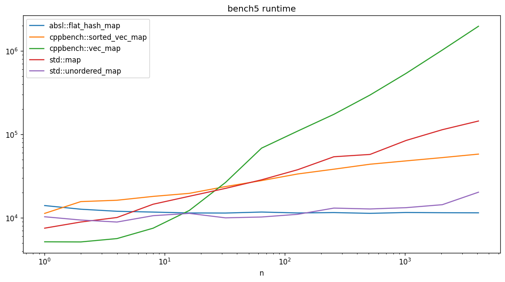

---

# Benchmark 6

- Pick a random key at each iteration (more realistic, but adds overhead)
- Add a "no-op" Map to measure this overhead

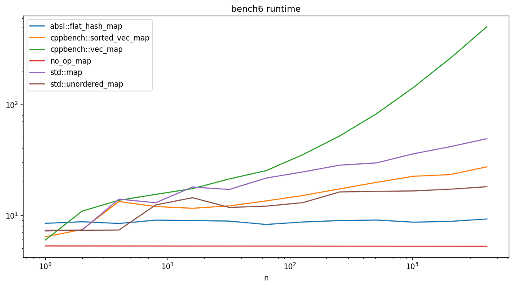

---

# Benchmark 7

- Try to simulate a "cold cache scenario"
  - Generate millions of identical maps (a few gig of RAM)
  - Pick a random map (probably not already in cache) for each benchmark iteration

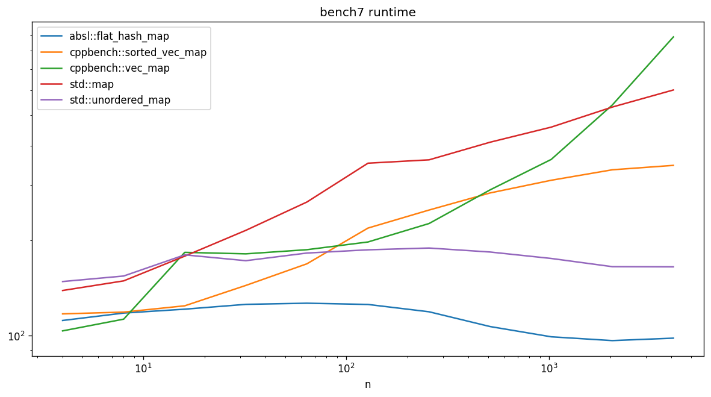

---

# Micro-benchmarking tips

- Compile in release mode
- Reduce the noise
  - Disable CPU turbo-boost / frequency scaling
  - Avoid running anything else at the same time
  - Repeat benchmarks to estimate noise, statistical significance of differences
- Try to be sure you're measuring what you intend to
  - Check the inputs and outputs are correct
  - Check the compiler is not optimizing away the work
  - Try to use or generate representative realistic input data
  - Compare timings with a no-op version of your operation / function
  - Look at the scaling as you vary the size of the input data
  - Try varying the order of the input data
  - Cold cache or hot cache scenario

---

<!-- _class: subtitle -->

# Profiling

---

# Profiling

- Run real production code on real hardware
- Not deterministic
- Sampling
  - Occasionally check what it's doing
    - Not too often to avoid interfering with execution / slowing it down!
  - Good to get an overview of real-world bottlenecks
  - Only sample a tiny fraction of events
    - But likely to find hotspots this way
- Instrumentation
  - Instrument specific functions in your code to measure
  - Good for keeping track of performance over time / identifying regressions
  - More upfront work: typically need to add instrumentation code, have a separate build, etc

---

# Profiler information

- Scheduler
  - CPU use of each thread vs time
  - Quick visual impression of multi-threading
- Top-down
  - Callgraph starting from main
  - Inclusive %: time spent in function and children
  - Exclusive %: time spent in function excluding children
  - Go from the function to the child functions it calls
- Bottom-up
  - % time spent inside each function
  - Go from the function to the parent functions that call it
  - Default view in perf
  - Note: inlined functions are not shown!

---

# Profiling tools

- [Perf](https://perfwiki.github.io/)
  - No special instrumentation or re-compilation of code required
  - Relatively simple to use, pre-installed on most linux distributions
  - But linux only, and [need sudo permissions](https://www.kernel.org/doc/html/latest/admin-guide/perf-security.html)
- [Intel VTune](https://www.intel.com/content/www/us/en/developer/tools/oneapi/vtune-profiler.html)
- [Likwid](https://github.com/RRZE-HPC/likwid)
- [Gperftools](https://github.com/gperftools/gperftools)
- [Orbit](https://github.com/google/orbit/)
- [Tracy](https://github.com/wolfpld/tracy)
- [Optick](https://optick.dev/)
- [and many more…](http://pramodkumbhar.com/2017/04/summary-of-profiling-tools/)

---

# Compiling for profiling

- Generally want to compile in Release mode
  - Goal is to run your code exactly as in real-world setting
- Additional flags to improve profile output at minimal cost:
  - `-g` : include debugging symbols (e.g. function names)
    - `CMAKE_BUILD_TYPE=RelWithDebInfo`
  - `-fno-omit-frame-pointer` : don't omit frame pointers (i.e. better stack traces)
- Any additional requirements for your profiler
  - Link to their library?
  - Include their header?
  - Instrument your code?
  - Set environment variables?

---

# Perf stat

- `perf stat ./app`
  - default performance counters
- `perf list`
  - show all available counters
- `perf stat -e L1-dcache-load-misses,L1-dcache-load ./app`
  - how often do we have a L1 data cache miss
- `perf stat -e branches,branch-misses ./app`
  - how often do we have a branch prediction miss

---

# Perf stat example

```console
perf stat -e L1-dcache-load-misses,L1-dcache-load \
  ./bench/bench6 \
  --benchmark_filter=".*:vec_map.*/16\$" \
  --benchmark_min_time=2
```

```text
      627,014      L1-dcache-load-misses     #    0.01% of all L1-dcache accesses
8,377,940,732      L1-dcache-load
```

- First line: Measure cache misses using perf stat
- Others: run n=16 `vec_map` benchmark from bench6 for at least 2 secs

---

# Branch prediction

- CPU constructs a pipeline of instructions
  - Often "out of order" i.e. not evaluated in the order you wrote them
  - E.g. part of iteration n+1 in a loop may be calculated in iteration n
  - You need to know what instructions are coming next to be able to do this
- At every branch (e.g. if statement) in the code
  - CPU doesn't know where execution will jump to next until condition is evaluated
  - This stalls the pipeline
- So it tries to guess the most likely outcome (branch prediction)
  - Constructs the pipeline based on guessing where the branch will jump to
- Sometimes it guesses wrong
  - This is called a "branch miss" (similar to a cache miss)
  - CPU has to throw away / undo a lot of potentially incorrect operations
  - Then find and execute the correct instructions from the correct branch
  - This is expensive (also similar to a cache miss)

---

# Perf branch prediction

<style scoped>
p { display: flex; justify-content: center; gap: 30px; }
p img { margin: 0; }
</style>

- Branch predictor is outsmarting our benchmark in bench5

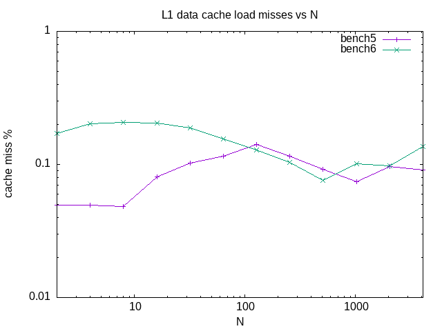 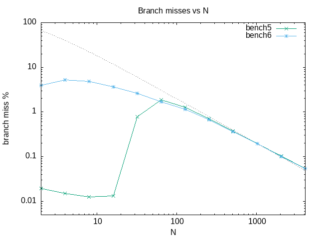

---

# Perf record

- `perf record ./app && perf report`
  - see annotated assembly with % of time for each line
    - `h`: show shortcuts
    - `H`: go to hotspot
    - `Enter`: go to function / follow jump

```console
perf record ./bench/bench5 --benchmark_filter=".*:vec_map.*/1024\$" --benchmark_min_time=2
perf report
```

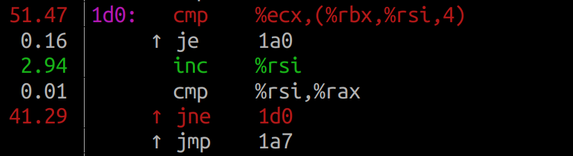

---

# Perf visualization

- Raw assembly can be overwhelming
- Can be easier to interpret a call graph, flame graph, etc
- Options (all inconvenient in different ways)
  - [KDAB/hotspot](https://github.com/KDAB/hotspot)
    - Works directly on perf.data, but output seems incomplete / wrong
  - [brendangregg/FlameGraph](https://github.com/brendangregg/FlameGraph)
    - Use supplied perl script to convert trace data first
  - [google/pprof](https://github.com/google/pprof)
    - But also need [google/perf_data_converter](https://github.com/google/perf_data_converter)
  - [Trace Compass](https://www.eclipse.org/tracecompass)
    - But you need to re-compile perf with CTF support

---

# Google Orbit

- GUI profilers can be more intuitive for complicated applications
- Google Orbit: [github.com/google/orbit](https://github.com/google/orbit)
- Build (requires conan)
  - `./bootstrap-orbit.sh --ignore-system-requirements`
  - `./build.sh gcc10_release`
- Start collector
  - `sudo ./build_gcc10_release/bin/OrbitService`
- Start frontend
  - `./build_gcc10_release/bin/Orbit --local`
- Select your process, start capture

---

# Top down

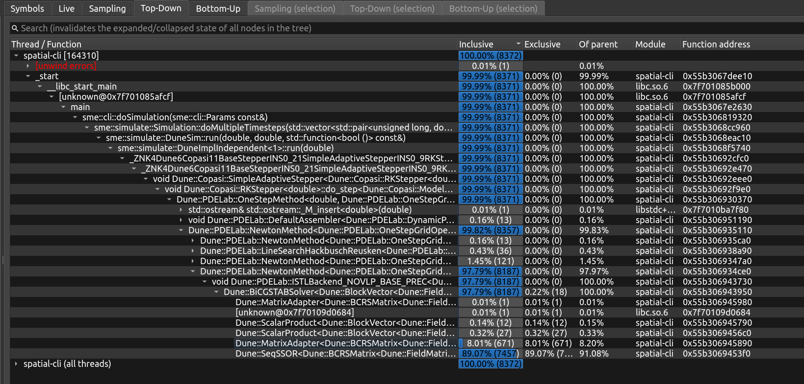

---

# Bottom up

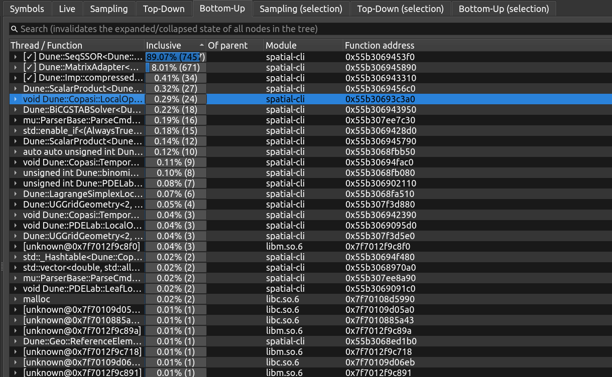

---

# Instrumentation - 1 thread

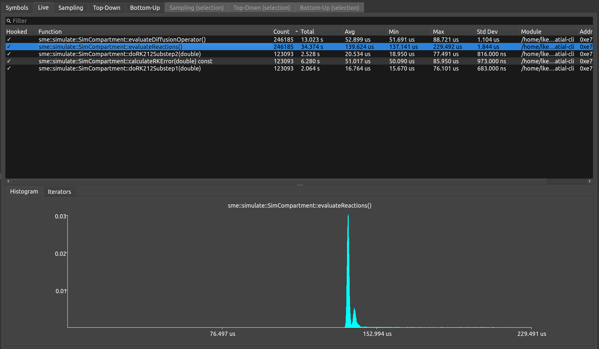

---

# Instrumentation - 12 threads

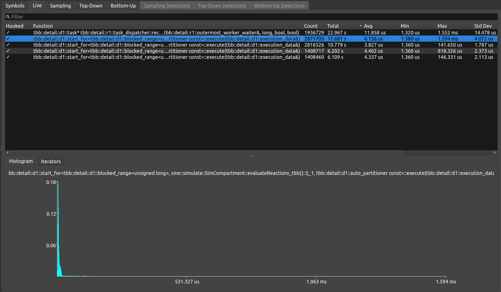

---

# Profiling tips

- Reduce the noise
  - Disable CPU turbo-boost / frequency scaling
  - Avoid running anything else at the same time
- First step: look at cache misses
  - If there are a lot of these, nothing else matters much
- Look at branch misses
  - Sometimes Profile Guided Optimization (PGO) can help
  - Very rarely you can improve them by hand (`__builtin_expect`, `[[likely]]`, etc)
  - But hard to do better than the CPU (and easy to make things worse!)
- Look at hotspots
  - Lines of code that are called a lot and/or slow
- Profile your benchmarks
  - Can help understand if they are testing what you want them to

---

<!-- _class: subtitle -->

# Simulation

---

# Simulation

- Run real production code on a virtual machine
  - Simulated CPU, simulated cache
- Record every cpu operation, every cache read, etc
  - Doesn't affect (simulated) speed of operations
- Deterministic
  - No statistical variation, not affected by other running processes
- But: not real hardware
  - No guarantee performance implications are the same
- Also: typically vastly slower than real-time (e.g. 50x slower)
  - Can be inconvenient / impractical for certain applications

---

# Callgrind/cachegrind

- Part of [valgrind](https://valgrind.org/) set of tools
  - Default tool is memcheck, but there are others!
- `valgrind --tool=cachegrind ./app`
  - Command line output of simulated cache hits/misses
- `valgrind --tool=callgrind --simulate-cache=yes ./app`
  - Generates call-graph data and cache hits/misses
- `kcachegrind`
  - GUI to visualize above data

---

# Example call graph (cycles)

<style scoped>
p { display: flex; justify-content: center; gap: 30px; }
p img { margin: 0; }
</style>

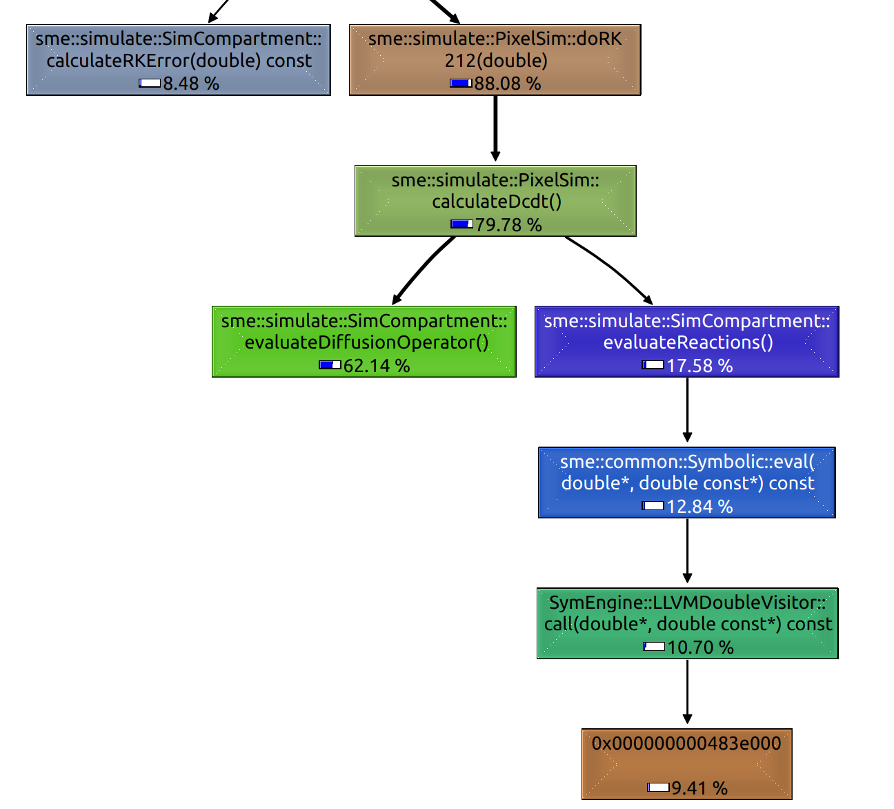 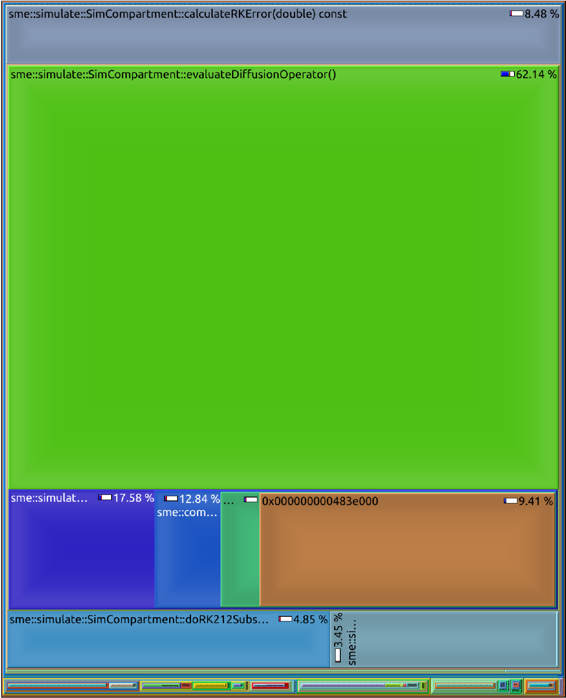

---

# Perf report for same code

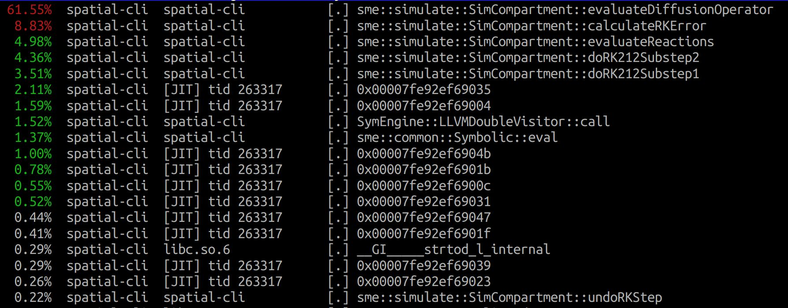

---

# Simulation tips

- Don't worry about the noise!
  - CPU turbo-boost, other running processes, etc are not relevant
- Otherwise, same tips as profiling
  - First step: look at cache misses
    - If there are a lot of these, nothing else matters much
  - Look at branch misses
    - Sometimes Profile Guided Optimization (PGO) can help
    - Very rarely you can improve them by hand (`__builtin_expect`, `[[likely]]`, etc)
    - But hard to do better than the CPU (and easy to make things worse!)
  - Look at hotspots
    - Lines of code that are called a lot and/or slow
  - Profile your benchmarks
    - Can help understand if they are testing what you want them to
- Remember it's a simulation - compare results with actual profiling data

---

<!-- _class: subtitle -->

# Summary

---

# Summary

- Benchmarking is vital but also difficult to do reliably
- Important not to blindly take one metric or benchmark as the "truth"
- We covered three complementary approaches
  - Micro-benchmarking
  - Profiling
  - Simulation
- Each have their own strengths and weaknesses
- Together they allow you to understand the performance of your code
- Also where and how to improve the performance of your code

---

# Recommended resources

**Benchmarking**

- Chandler Carruth talks on benchmarking/performance
  - [Tuning C++: Benchmarks, and CPUs, and Compilers! Oh My!](https://www.youtube.com/watch?v=nXaxk27zwlk)
  - [Efficiency with Algorithms, Performance with Data Structures](https://www.youtube.com/watch?v=fHNmRkzxHWs)
  - [Going Nowhere Faster](https://www.youtube.com/watch?v=2EWejmkKlxs)
- Fedor Pikus talk on branchless programming
  - [Branchless Programming in C++](https://www.youtube.com/watch?v=g-WPhYREFjk)

**Profiling**

- [Summary of profiling tools](http://pramodkumbhar.com/2017/04/summary-of-profiling-tools/)

---

# Recommended resources

**Performance**

- Mike Acton talk on data oriented design
  - [Data-Oriented Design and C++](https://www.youtube.com/watch?v=rX0ItVEVjHc)
- Ulrich Drepper paper on memory and cache
  - [What Every Programmer Should Know About Memory](https://www.akkadia.org/drepper/cpumemory.pdf)
  - Not for "every programmer" but excellent info on RAM / cache / performance
  - From 2007 but still very relevant
- A curated list of C++ performance-related resources
  - [AwesomePerfCpp](https://fenbf.github.io/AwesomePerfCpp/)

---

# More recommended resources

**Hash maps**

- Malte Skarupke talk on hash map implementations and performance
  - [You Can Do Better than std::unordered_map](https://www.youtube.com/watch?v=M2fKMP47slQ)
- Matt Kulukundis talks on Google's hash map
  - [Designing a Fast, Efficient, Cache-friendly Hash Table, Step by Step](https://www.youtube.com/watch?v=ncHmEUmJZf4)
  - [Abseil's Open Source Hashtables: 2 Years In](https://www.youtube.com/watch?v=JZE3_0qvrMg)
